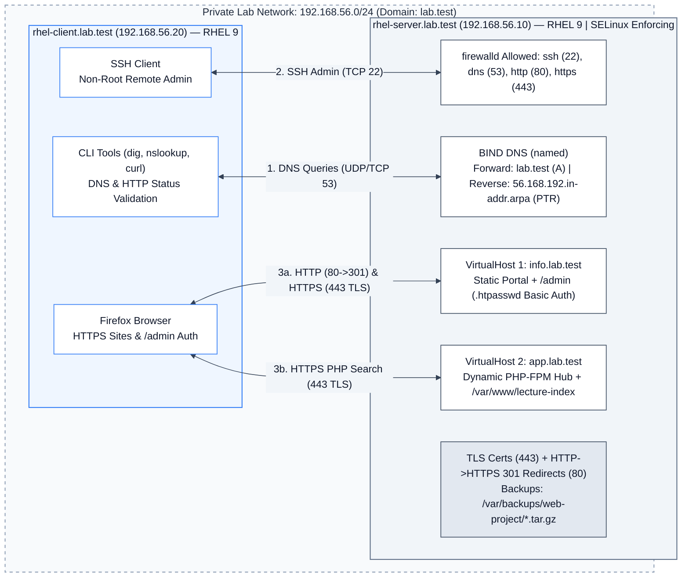

# COP 3350 — Multi-Service RHEL 9 Infrastructure (`lab.test`)

This repository contains the configuration files, web application source code, lecture metadata index, and deployment runbook for our **COP 3350 (Systems Administration)** group project. The infrastructure deploys an authoritative BIND DNS service and a hardened, multi-tenant Apache (`httpd`) + PHP-FPM web tier across two Red Hat Enterprise Linux 9 (RHEL 9) virtual machines on an isolated `192.168.56.0/24` subnet.

---

## 1. Network Architecture & Host Overview




| Hostname / VirtualHost | IP Address | Role & Services | Key Paths |
| :--- | :--- | :--- | :--- |
| **`rhel-server.lab.test`** (`ns1.lab.test`) | `192.168.56.10` | Primary Infrastructure Server (`named`, `httpd`, `php-fpm`, `sshd`, `firewalld`) | `/etc/named.conf`, `/var/named/`, `/etc/httpd/conf.d/` |
| **`info.lab.test`** | `192.168.56.10` | VirtualHost 1: Static Informational Portal + Restricted `/admin` Dashboard | `/var/www/info.lab.test/html`, `/etc/httpd/conf/.htpasswd` |
| **`app.lab.test`** | `192.168.56.10` | VirtualHost 2: Dynamic PHP-FPM COP 3350 Lecture Resource Hub | `/var/www/app.lab.test/html`, `/var/www/lecture-index/lectures.csv` |
| **`rhel-client.lab.test`** | `192.168.56.20` | Verification & Administration Client (`dig`, `nslookup`, `curl`, `firefox`, `ssh`) | Queries `192.168.56.10` exclusively for DNS |

---


## 2. Key Technical Decisions

* **Dual-NIC Network Isolation:** Each VM uses a NAT adapter (`enp0s1`) strictly for `dnf` package installation and a Host-Only/Internal adapter (`enp0s2`) configured on `192.168.56.0/24` for all lab service traffic.
* **Authoritative Split-Zone DNS (BIND):** Instead of relying on static `/etc/hosts` overrides on the client, `rhel-server` runs BIND (`named`) with both a forward zone (`lab.test`) and reverse zone (`56.168.192.in-addr.arpa`) so all hostnames and VirtualHosts resolve dynamically over port 53.
* **Name-Based VirtualHosting & Mandatory TLS:** Both `info.lab.test` and `app.lab.test` share `192.168.56.10`. Port `80` VirtualHosts issue strict `301 Moved Permanently` redirects to port `443` (`mod_ssl`), preventing plaintext exposure of HTTP Basic Auth credentials on `/admin`.
* **Out-of-Root Lecture Metadata Index:** The CSV catalog (`/var/www/lecture-index/lectures.csv`) used by `app.lab.test` is stored outside the public `DocumentRoot` (`/var/www/app.lab.test/html`) so users can search metadata via PHP without directly downloading the raw database file.
* **SELinux Enforcing & Least-Privilege Permissions:** SELinux remains in `Enforcing` mode at all times. Custom directories use persistent `httpd_sys_content_t` file contexts (`semanage fcontext` + `restorecon`), directories require `755` (`drwxr-xr-x`) traversal permissions so PHP `is_file()` checks succeed on `/slides`, and regular files use `644` (`-rw-r--r--`).

--- 


## 3. Required Packages & Tools

Before deploying the configurations on **`rhel-server`** (`192.168.56.10`), install the required server daemons and SELinux management utilities:

```bash
sudo dnf install -y httpd mod_ssl php php-fpm php-cli \
    bind bind-utils firewalld policycoreutils-python-utils tar curl
```

On **`rhel-client`** (`192.168.56.20`), ensure validation tools are installed:

```bash
sudo dnf install -y bind-utils curl firefox openssh-clients
```

--- 


## 4. Server Setup & Deployment `rhel-server`

If you are pulling this repository onto a fresh VM to replicate or test the environment, run the steps below from the root of the `Group-1` repository.

### Step 1: Enable Core Services & Configure `firewalld`
```bash
sudo systemctl enable --now firewalld httpd php-fpm sshd

sudo firewall-cmd --permanent --add-service=http
sudo firewall-cmd --permanent --add-service=https
sudo firewall-cmd --permanent --add-service=dns
sudo firewall-cmd --permanent --add-service=ssh
sudo firewall-cmd --reload
sudo firewall-cmd --list-all
```

### Step 2: Create Web Directories & Copy Site Assets
```bash
sudo mkdir -p /var/www/info.lab.test/html/admin
sudo mkdir -p /var/www/app.lab.test/html/slides
sudo mkdir -p /var/www/lecture-index

# Copy static portal, dynamic PHP hub, and lecture index from repo
sudo cp -r info.lab.test/* /var/www/info.lab.test/html/
sudo cp -r app.lab.test/* /var/www/app.lab.test/html/
sudo cp lecture-index/lectures.csv /var/www/lecture-index/
``` 

### Step 3: Generate TLS Certificates & Basic Auth Credentials
```bash
# Generate self-signed certificates for info.lab.test and app.lab.test
sudo openssl req -x509 -nodes -days 365 -newkey rsa:2048 \
    -keyout /etc/pki/tls/private/info.lab.test.key \
    -out /etc/pki/tls/certs/info.lab.test.crt \
    -subj "/C=US/ST=FL/L=FortMyers/O=FGCU/OU=COP3350/CN=info.lab.test"

sudo openssl req -x509 -nodes -days 365 -newkey rsa:2048 \
    -keyout /etc/pki/tls/private/app.lab.test.key \
    -out /etc/pki/tls/certs/app.lab.test.crt \
    -subj "/C=US/ST=FL/L=FortMyers/O=FGCU/OU=COP3350/CN=app.lab.test"

# Create HTTP Basic Auth password file for https://info.lab.test/admin
sudo htpasswd -c /etc/httpd/conf/.htpasswd admin
sudo chown root:apache /etc/httpd/conf/.htpasswd
sudo chmod 640 /etc/httpd/conf/.htpasswd
```

### Step 4: Deploy Apache VirtualHost Configs
```bash
sudo cp apache/*.conf /etc/httpd/conf.d/
echo "ServerName rhel-server.lab.test" | sudo tee /etc/httpd/conf.d/servername.conf
```

### Step 5: Enforce Ownership, Permissions & SELinux Contexts
> **Important:** Directories (`html`, `slides`, `admin`, `lecture-index`) **must** keep `755` (`+x`) permissions so Apache and PHP-FPM can traverse them and stat PDF files.

```bash
sudo chown -R apache:apache /var/www/info.lab.test /var/www/app.lab.test /var/www/lecture-index

sudo find /var/www/info.lab.test /var/www/app.lab.test /var/www/lecture-index -type d -exec chmod 755 {} \;
sudo find /var/www/info.lab.test /var/www/app.lab.test /var/www/lecture-index -type f -exec chmod 644 {} \;

sudo semanage fcontext -a -t httpd_sys_content_t "/var/www/info\.lab\.test(/.*)?"
sudo semanage fcontext -a -t httpd_sys_content_t "/var/www/app\.lab\.test(/.*)?"
sudo semanage fcontext -a -t httpd_sys_content_t "/var/www/lecture-index(/.*)?"
sudo restorecon -Rv /var/www/info.lab.test /var/www/app.lab.test /var/www/lecture-index

sudo httpd -t && sudo systemctl restart php-fpm httpd
```
