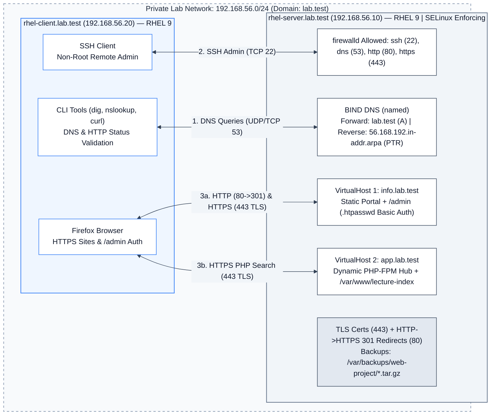

# COP 3350 — Multi-Service RHEL 9 Infrastructure (`lab.test`)

This repository contains the configuration files, web application source code, lecture metadata index, and deployment runbook for our **COP 3350 (Systems Administration)** group project. The infrastructure deploys an authoritative BIND DNS service and a hardened, multi-tenant Apache (`httpd`) + PHP-FPM web tier across two Red Hat Enterprise Linux 9 (RHEL 9) virtual machines on an isolated `192.168.56.0/24` subnet.

---

## 1. Network Architecture & Host Overview

| Hostname / VirtualHost | IP Address | Role & Services | Key Paths |
| :--- | :--- | :--- | :--- |
| **`rhel-server.lab.test`** (`ns1.lab.test`) | `192.168.56.10` | Primary Infrastructure Server (`named`, `httpd`, `php-fpm`, `sshd`, `firewalld`) | `/etc/named.conf`, `/var/named/`, `/etc/httpd/conf.d/` |
| **`info.lab.test`** | `192.168.56.10` | VirtualHost 1: Static Informational Portal + Restricted `/admin` Dashboard | `/var/www/info.lab.test/html`, `/etc/httpd/conf/.htpasswd` |
| **`app.lab.test`** | `192.168.56.10` | VirtualHost 2: Dynamic PHP-FPM COP 3350 Lecture Resource Hub | `/var/www/app.lab.test/html`, `/var/www/lecture-index/lectures.csv` |
| **`rhel-client.lab.test`** | `192.168.56.20` | Verification & Administration Client (`dig`, `nslookup`, `curl`, `firefox`, `ssh`) | Queries `192.168.56.10` exclusively for DNS |

---

| Hostname / VirtualHost | IP Address | Role & Services | Key Paths |
| :--- | :--- | :--- | :--- |
| **`rhel-server.lab.test`** (`ns1.lab.test`) | `192.168.56.10` | Primary Infrastructure Server (`named`, `httpd`, `php-fpm`, `sshd`, `firewalld`) | `/etc/named.conf`, `/var/named/`, `/etc/httpd/conf.d/` |
| **`info.lab.test`** | `192.168.56.10` | VirtualHost 1: Static Informational Portal + Restricted `/admin` Dashboard | `/var/www/info.lab.test/html`, `/etc/httpd/conf/.htpasswd` |
| **`app.lab.test`** | `192.168.56.10` | VirtualHost 2: Dynamic PHP-FPM COP 3350 Lecture Resource Hub | `/var/www/app.lab.test/html`, `/var/www/lecture-index/lectures.csv` |
| **`rhel-client.lab.test`** | `192.168.56.20` | Verification & Administration Client (`dig`, `nslookup`, `curl`, `firefox`, `ssh`) | Queries `192.168.56.10` exclusively for DNS |

---

